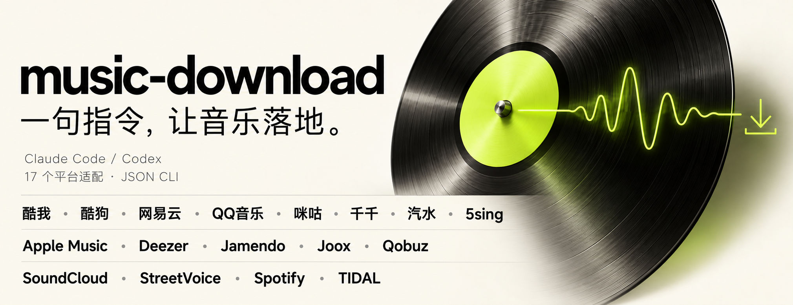

# music-download

<p align="center">
  
</p>

<p align="center">
  <a href="README.md"><b>中文</b></a> · <a href="README_EN.md">English</a>
</p>

**让 AI Agent 直接搜索与下载音乐。** music-download 是一个自带运行脚本的多平台音乐 skill，支持搜索歌曲、选择版本、单曲与批量下载、解析歌单，结果保存到本地。

做视频找配乐、查找某首歌的指定版本，或整理歌单时，直接把需求交给 Agent。你可以指定平台，也可以让它根据需求选择。底层调用 musicdl，使用独立的 Python 环境，无需桌面应用。

Agent 需要能够读取本地文件、执行 Shell 命令、联网并保存文件。支持 skill 的工具可以从技能目录加载；其他具备这些能力的 Agent，也可以先读取 [SKILL.md](SKILL.md)，再按说明调用脚本。

## 视频介绍

**music-download｜一句指令，让音乐落地。**

https://github.com/user-attachments/assets/51048840-03d2-44b1-bbdb-de32c9d69690

## 安装

需要 **Git 和 uv**。安装脚本会创建 Python 3.13 环境并安装固定版本依赖。当前实测环境为 macOS arm64，脚本使用 POSIX shell。

### 交给 Agent 安装

将下面的指令发给具备本地命令执行能力的 Agent：

> 帮我安装 https://github.com/ln2146/music-download 到你使用的技能目录，阅读 SKILL.md 并执行 scripts/setup.sh，然后运行 scripts/music sources 确认安装结果。如果你没有技能目录，就安装到当前工作目录，后续按 SKILL.md 调用。

### 手动安装

在希望保存 skill 的目录中执行：

```sh
git clone https://github.com/ln2146/music-download.git music-download
sh music-download/scripts/setup.sh
music-download/scripts/music sources
```

然后让 Agent 读取安装目录中的 `SKILL.md`，按说明搜索、解析歌单或下载歌曲。自动发现 skill 的目录因工具而异，下面提供两种安装示例。

<details>
<summary>Claude Code / Codex 安装目录示例</summary>

**Claude Code**

```sh
git clone https://github.com/ln2146/music-download.git ~/.claude/skills/music-download
sh ~/.claude/skills/music-download/scripts/setup.sh
~/.claude/skills/music-download/scripts/music sources
```

**Codex**

```sh
git clone https://github.com/ln2146/music-download.git ~/.codex/skills/music-download
sh ~/.codex/skills/music-download/scripts/setup.sh
~/.codex/skills/music-download/scripts/music sources
```

自定义了 `CODEX_HOME` 时，使用对应的 `skills` 目录。

</details>

目标目录已有安装时，先检查并保留本地修改。每个安装目录分别执行 `setup.sh`；迁移目录后重新创建环境，不直接复制已有 `.venv`。

## 使用

安装并让 Agent 加载 `SKILL.md` 后，直接提出需求：

**让 Agent 选择平台并下载**

> 使用 music-download，帮我下载周杰伦演唱的《晴天》，平台你来选，保存到当前项目的已下载音乐目录。

**指定平台，先看候选**

> 使用 music-download，只在网易云和 QQ 音乐里搜索《晴天》，先列出候选让我选。

**从歌单中选择歌曲**

> 使用 music-download，解析这个歌单并列出歌曲，下载我选中的几首。

仅要求搜索时只搜索；明确要求下载且匹配清楚时继续执行。同名歌、翻唱或现场版有歧义时，Agent 会展示候选。完整调用规则见 [SKILL.md](SKILL.md)。

<details>
<summary>进阶：直接调用命令行</summary>

以下命令在仓库根目录执行。stdout 为 JSON，退出码 `1` 可能表示部分成功，仍需读取各项结果。

```sh
# 列出平台与别名
./scripts/music sources

# 在指定平台搜索
./scripts/music search --query "晴天 周杰伦" --sources netease,qq --limit 3

# 替换搜索返回的 search_id 和实际候选 ID 后下载
./scripts/music download --search-id "<search_id>" --items qq:1 --output "$PWD/已下载音乐"

# 解析歌单，返回候选，后续按需求调用下载
./scripts/music playlist --sources streetvoice --url 'https://www.streetvoice.cn/svmusic_cn/playlists/880153/' --timeout 300
```

脚本要求显式传入搜索平台。自然语言请求未指定平台时，由 Agent 决定参数；脚本不内置固定的平台优先顺序或自动替代源。

</details>

## 支持平台

共 **17 个平台适配器**：

酷我 · 酷狗 · 网易云 · QQ音乐 · 咪咕 · 千千 · 汽水 · 5sing<br>
Apple Music · Deezer · Jamendo · Joox · Qobuz · SoundCloud · StreetVoice · Spotify · TIDAL

部分平台需要账号或额外配置，部分解析路径使用第三方服务。实际可用性受接口、地区、账号与网络条件影响。平台 ID、别名和配置要求见 [平台与配置](references/platforms.md)。

## 配置

- **账号配置**：`~/.config/music-download/config.json`，可选。
- **搜索状态与日志**：`~/.local/share/music-download`。
- **自定义路径**：在子命令前使用 `--config <文件>`、`--state-dir <目录>`。
- **执行期限**：每个平台默认 120 秒，用 `--timeout` 调整；较长歌单可适当增加。

账号凭据由用户在本地配置。状态包含原生歌曲对象快照和私有日志，可能带有临时授权信息，不应分享状态目录或加载他人提供的 pickle、状态库。详细字段见 [平台与配置](references/platforms.md)。

## 项目来源与许可

核心平台能力来自 [musicdl](https://github.com/CharlesPikachu/musicdl)，早期需求参考了 [MrsEWE44/musicDownload](https://github.com/MrsEWE44/musicDownload) 桌面项目的功能范围。

本仓库不附带歌曲文件、共享账号或第三方解析服务的凭据。依赖项目有各自的许可证；musicdl 2.14.2 随包提供 PolyForm Noncommercial License 1.0.0，使用时请阅读其许可证。
