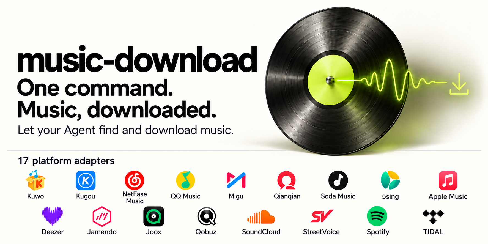

# music-download

<p align="center">
  
</p>

<p align="center">
  <a href="README.md">中文</a> · <a href="README_EN.md"><b>English</b></a>
</p>

**Let your AI Agent find and download music.** music-download is a multi-platform music skill with its own runnable scripts. Search for songs, choose a version, download individual tracks or batches, and parse playlists, with results saved locally.

Find music for a video, look for a specific recording, or work through a playlist by telling your Agent what you need. Choose the platforms yourself or let the Agent select them. The skill calls musicdl in an isolated Python environment, with no desktop application required.

Your Agent needs to read local files, run Shell commands, access the internet and save files. Tools with skill support can load it from their skills directory. Other Agents with these capabilities can read [SKILL.md](SKILL.md) and follow its instructions to call the scripts.

## Installation

You need **Git and uv**. The setup script creates a Python 3.13 environment and installs pinned dependencies. The environment tested so far is macOS arm64; the script uses POSIX shell.

### Ask your Agent to install it

Send this instruction to an Agent that can execute local commands:

> Install https://github.com/ln2146/music-download in your skills directory. Read SKILL.md, run scripts/setup.sh, then run scripts/music sources to check the installation. If you do not have a skills directory, install it in the current working directory and follow SKILL.md when using it.

### Install manually

Run these commands in the directory where you want to keep the skill:

```sh
git clone https://github.com/ln2146/music-download.git music-download
sh music-download/scripts/setup.sh
music-download/scripts/music sources
```

Then ask your Agent to read `SKILL.md` in the installation directory and follow its instructions to search, parse playlists or download songs. Skill discovery paths vary by tool; two examples follow.

<details>
<summary>Installation directory examples for Claude Code / Codex</summary>

**Claude Code**

```sh
git clone https://github.com/ln2146/music-download.git ~/.claude/skills/music-download
sh ~/.claude/skills/music-download/scripts/setup.sh
~/.claude/skills/music-download/scripts/music sources
```

**Codex**

```sh
git clone https://github.com/ln2146/music-download.git ~/.codex/skills/music-download
sh ~/.codex/skills/music-download/scripts/setup.sh
~/.codex/skills/music-download/scripts/music sources
```

If you customized `CODEX_HOME`, use its corresponding `skills` directory.

</details>

If the destination already contains an installation, inspect and preserve local changes first. Run `setup.sh` separately for each installation. Recreate the environment after moving the skill; do not copy an existing `.venv` to a new location.

## Usage

Once installed and loaded by your Agent, describe what you need:

**Let the Agent choose platforms and download**

> Use music-download to download Jay Chou's recording of "晴天". Choose the platforms and save it to a downloaded-music directory in the current project.

**Specify platforms and review candidates first**

> Use music-download to search for "晴天" on NetEase Cloud Music and QQ Music only. Show me the candidates before downloading.

**Choose tracks from a playlist**

> Use music-download to parse this playlist and list its tracks. Download the ones I select.

Search-only requests stay search-only. When a download is explicitly requested and the match is clear, the Agent continues with the download. If the artist, cover or live version is ambiguous, it presents candidates. See [SKILL.md](SKILL.md) for the full agent instructions.

<details>
<summary>Advanced: use the command line directly</summary>

Run the following commands from the repository root. stdout contains JSON. Exit code `1` can indicate partial success, so read each item's result.

```sh
# List platforms and aliases
./scripts/music sources

# Search on specified platforms
./scripts/music search --query "晴天 周杰伦" --sources netease,qq --limit 3

# Replace the placeholders with the search_id and candidate IDs returned by search
./scripts/music download --search-id "<search_id>" --items qq:1 --output "$PWD/downloaded-music"

# Parse a playlist into candidates; download them separately as requested
./scripts/music playlist --sources streetvoice --url 'https://www.streetvoice.cn/svmusic_cn/playlists/880153/' --timeout 300
```

The script requires explicit search platforms. If a natural-language request does not specify them, the Agent chooses the parameters. The script has no fixed platform priority or automatic replacement source.

</details>

## Platforms

**17 platform adapters**:

Kuwo · Kugou · NetEase Cloud Music · QQ Music · Migu · Qianqian · Soda Music · 5sing<br>
Apple Music · Deezer · Jamendo · Joox · Qobuz · SoundCloud · StreetVoice · Spotify · TIDAL

Some platforms require an account or extra configuration, and some resolution paths use third-party services. Availability depends on APIs, region, account access and network conditions. See [Platforms and configuration](references/platforms.md) (Chinese) for platform IDs, aliases and configuration requirements.

## Configuration

- **Account configuration**: `~/.config/music-download/config.json`, optional.
- **Search state and logs**: `~/.local/share/music-download`.
- **Custom paths**: pass `--config <file>` or `--state-dir <directory>` before the subcommand.
- **Execution deadline**: 120 seconds per platform by default; adjust with `--timeout`, especially for longer playlists.

Configure credentials locally. State includes snapshots of native song objects and private logs, which may contain temporary authorization information. Do not share the state directory or load pickle files or state databases supplied by others. See [Platforms and configuration](references/platforms.md) (Chinese) for details.

## Credits and licensing

Core platform capabilities come from [musicdl](https://github.com/CharlesPikachu/musicdl). The initial feature scope was informed by the [MrsEWE44/musicDownload](https://github.com/MrsEWE44/musicDownload) desktop project.

This repository does not include song files, shared accounts or credentials for third-party resolution services. Dependencies have their own licenses. musicdl 2.14.2 ships with the PolyForm Noncommercial License 1.0.0; review its terms before use.
